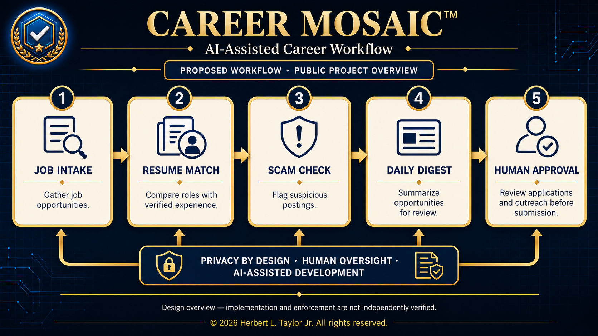

# Career Mosaic™

Career Mosaic is my personal AI-assisted career workflow, designed to keep a job search calm,
focused, and safe. This repository is a public overview only.

*AI-assisted public design overview. Implementation and approval enforcement have not been independently verified; the graphic is not evidence of deployed integrations.*

## What it does
- **Job intake** — gathers job openings and professional inquiries into one place.
- **Resume-match scoring** — highlights the opportunities that best fit my experience.
- **Scam check** — screens postings and messages for fraud and unsafe requests.
- **Calm daily digest** — one short daily summary instead of a constant stream of alerts.
- **Human-approved applications** — applications and outreach wait for my approval.
  Nothing is submitted automatically.

## Principles
- A human approves every external action
- Privacy by design
- Only the information needed for the task

## My role
Product owner, workflow designer, and AI-assisted implementation lead.

## AI-assisted development

Developed with AI-assisted coding tools. I defined the requirements, workflow design, privacy boundaries, and human-approval rules. This repository presents a public project overview; it does not contain the implementation source code.

## Related
- [Secure AI Career Operations Workflow](https://github.com/hltaylorjr/secure-ai-career-operations-workflow)
- [herbertltaylor.com](https://herbertltaylor.com)

---
All rights reserved. No license is granted to copy, modify, or reuse this project, its documentation, or its name.
